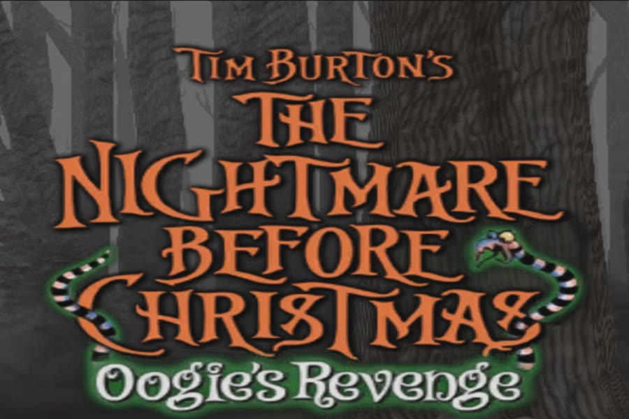
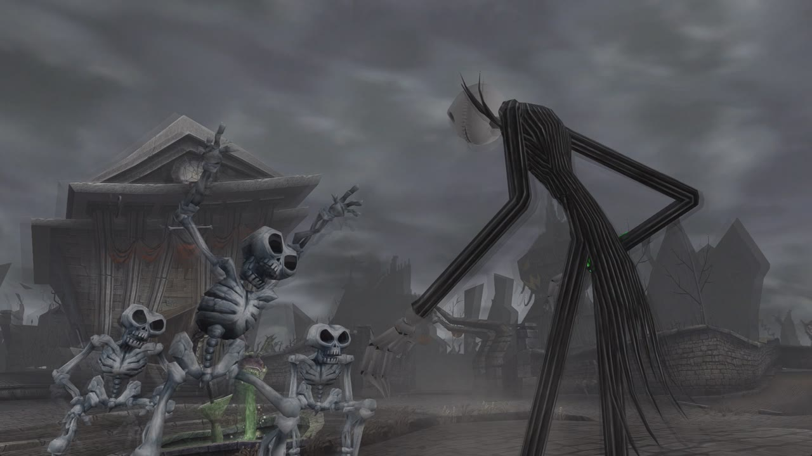
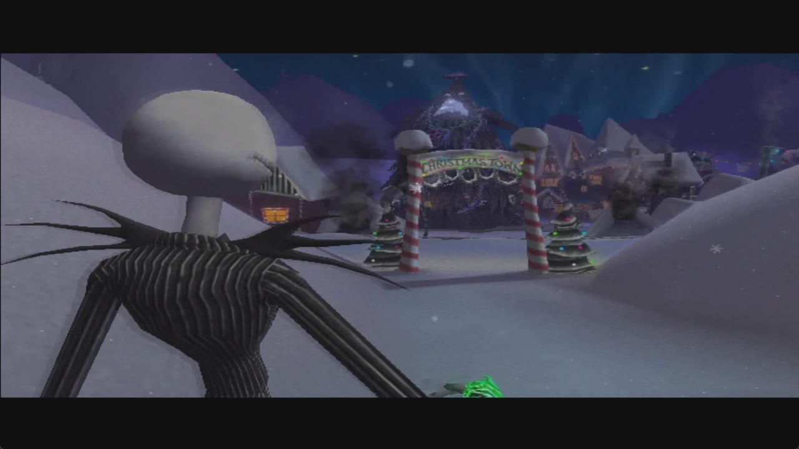
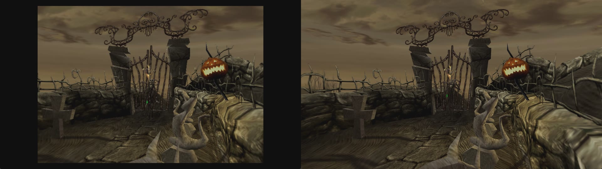
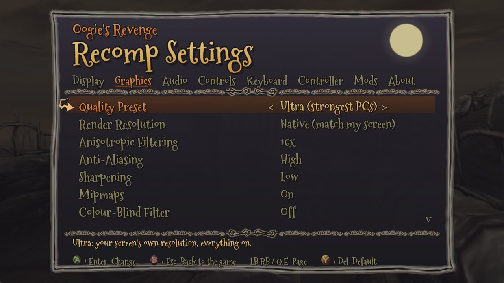
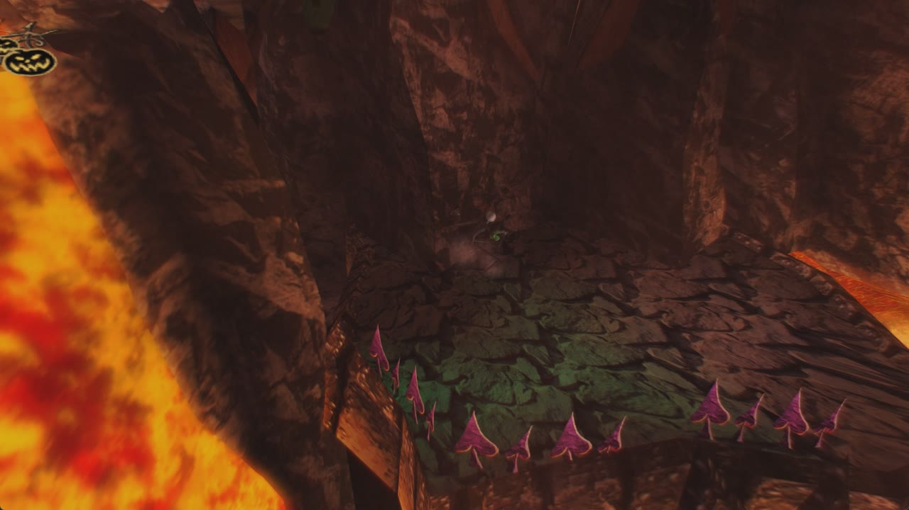

<p align="center">
  
</p>

<h1 align="center">Project Oogie</h1>
<p align="center"><b>A native Windows PC port of <i>The Nightmare Before Christmas: Oogie's Revenge</i> (Xbox, 2005)</b><br>
made by static recompilation &middot; version 0.1 &middot; a fan project by <a href="https://github.com/Pallypots">Pallypots</a></p>

<p align="center">
  
  
</p>

---

## What is this?

Project Oogie runs the original Xbox game **natively on Windows**, without an emulator.

It is a **recompilation**, not a decompilation:

| | Decompilation | Recompilation (this project) |
|---|---|---|
| What is made | Hand-written C that rebuilds the game's source code, function by function | The game's own Xbox program, translated machine instruction by instruction into C by a tool, then compiled for PC |
| How long it takes | Years of manual work | The whole game at once: 10,534 functions, translated automatically |
| How faithful | As faithful as the people rewriting it | The original code itself, running natively |

The translation is done with [XboxRecomp](https://github.com/sp00nznet/xboxrecomp). The parts of the Xbox the game talks to (its kernel, the NV2A graphics chip, the sound chip, the controller ports) are reimplemented for Windows: graphics go through Direct3D 11, sound through XAudio2, controllers through XInput and SDL2. Everything the PC port adds (the settings menu, widescreen, higher resolutions, accessibility options) is built around the game, never by changing its data.

**You need your own copy of the game.** The port reads the art, sound, films and levels from your own disc image on first start. It does not include them.

## Features

<p align="center"><br>
<i>Left: the original 640 x 480, 4:3 picture. Right: the port, widescreen at the screen's own resolution.</i></p>

### Picture
- **Widescreen** that shows more of the world, not a stretched picture. The HUD can sit in the screen corners. Films and menus keep their 4:3 shape, with black, blurred or stretched sides (your choice).
- **Render resolution**: Auto (the best that holds 60 fps), Native (your screen's own size), or a fixed size from 480p to 2160p. Tested up to 1800 lines.
- **Quality presets**: Low, Medium, High, Ultra. One choice sets all of the picture options below.
- **Anti-aliasing** (Off, Low, High), **sharpening** (Off to High), **anisotropic filtering** (up to 16x).
- **Mipmaps**: smooth distant textures with no shimmer. The game asks for them, but the original ships none.
- **Field of view** from 70% to 140%.

### Smooth play
- **Locked 60 fps**, the game's own speed. Its logic, films and music stay in time.
- Fast texture loading (about 13 times less work than a plain decoder) and no pauses from the program's own logging.
- **Battery aware**: on a laptop running on battery, Auto resolution starts lower.
- Picks the fast graphics card on laptops with two.

### Controls
- **Controllers**: Xbox controllers (XInput) and PlayStation 5 DualSense (tested), plus other SDL2 pads such as PlayStation 4, by cable or Bluetooth, with hot-plugging and rumble.
- **Keyboard and mouse**, with every key and every controller button rebindable in the menu.
- Proper stick dead zones, and full-speed running on diagonals with modern round-gated sticks.

### Accessibility
- **Colour-blind filter**: protanopia, deuteranopia and tritanopia correction.
- **Auto-repeat held button**: hold A, B, X or Y and it presses itself about ten times a second, so button-mashing moments need only a hold.
- Volume, mute and pause when the game is in the background.

### Quality of life
- **In-game settings menu** (press **F1**, or Back + Start on a controller), drawn with the game's own frames, cursor and buttons. Every change applies at once and is saved.
- **First-start setup**: point it at your disc image; it checks it and copies the game files.
- **Skip intro logos**, **F11** fullscreen, **F12** screenshots (PNG at full resolution); the window remembers its size and place.
- **Save backups**: the last ten copies of your saves are kept.
- Crash reports with the log, if something ever goes wrong.

### Mods
- **Replacement files**: `mods\<Mod Name>\files\<path on the disc>` (for example, a replacement film).
- **Texture packs**: switch on *Save Game Textures*, and every texture the game shows is saved to `texture_dump\` as `<width>x<height>_<hash>.png`. Edit or upscale it and put it, under the same name, in `mods\<Mod Name>\textures\`. Any size works.
- Mods are switched on and off on the menu's **Mods** page.

<p align="center">
  
  
</p>

## Playing

See [requirements.txt](requirements.txt) for what you need. In short: 64-bit Windows 10 or 11, a Direct3D 11 graphics card, and your own disc image of the **USA Xbox version** (title ID 42560004).

1. Download the release zip from the [Releases](https://github.com/Pallypots/ProjectOogie/releases) page and unzip it anywhere.
2. Run `Project Oogie.exe`. The first time, it asks for your disc image, checks that it is the supported version, and copies the game files next to the program (about 3.5 GB, once). The disc image is only read, never changed.
3. Press **F1** for the settings menu.

Default keyboard: **WASD** move, **arrow keys** are A/B/X/Y (Down A, Right B, Left X, Up Y), **T F G H** the d-pad, **Enter** Start, **Backspace** Back. All of them can be changed in F1 > Keyboard.

## Status (version 0.1)

- The whole game loads and runs. Automated checks start every one of the 24 chapters and play it for three minutes, at 60 fps, with no crashes.
- Played by hand from the start into Chapter 7 so far.
- Known issues are tracked openly in [docs/KNOWN_ISSUES.md](docs/KNOWN_ISSUES.md). Still open: the widescreen door transition is missing its side pieces (#60), and the results screen skips some announcer lines (#47).
- Not built yet: frame rates above 60 (the game's logic runs per frame, so this needs more work).

Please report problems with the log file: `logs\play.log` next to the program.

## Building from source

You need Visual Studio 2022 (MSVC, x64), CMake 3.20+, Git and Python 3.10+ (`pip install -r requirements.txt`).

1. Clone this repository, then XboxRecomp v0.14.0 into `third_party\xboxrecomp`:
   ```
   git clone https://github.com/sp00nznet/xboxrecomp third_party/xboxrecomp
   git -C third_party/xboxrecomp checkout eb0aa1d
   ```
2. Put the game's `default.xbe` and files in `game\` (or run a release build once, which extracts them).
3. Run `powershell -ExecutionPolicy Bypass -File scripts\regen.ps1`. It disassembles the program, translates it to C, builds it with CMake, and puts `oogie_recomp.exe` in `bin\`.

How the port works, and everything learned while making it, is written up in [docs/OOGIE_PORT_HANDBOOK.md](docs/OOGIE_PORT_HANDBOOK.md), [docs/REVERSE_ENGINEERING.md](docs/REVERSE_ENGINEERING.md) and [docs/PC_FEATURES.md](docs/PC_FEATURES.md).

## Credits and legal

- *The Nightmare Before Christmas: Oogie's Revenge* is © 2005 Touchstone Pictures / Disney, developed by Capcom and TOSE. This is an unofficial fan project, not affiliated with or endorsed by them. The screenshots in this README are of the game running in this port.
- The program contains the game's code, translated to native code. The game's art, sound, films and levels are not included: they come from your own disc. Please own the game.
- The port's own code is MIT licensed (see [LICENSE](LICENSE)). Third-party parts and their licenses are in [THIRD-PARTY-NOTICES.md](THIRD-PARTY-NOTICES.md): XboxRecomp (MIT), SDL2 (zlib), the Mountains of Christmas font (Apache 2.0).
- xemu and Cxbx-Reloaded served as references for how the Xbox behaves. None of their code is included.
